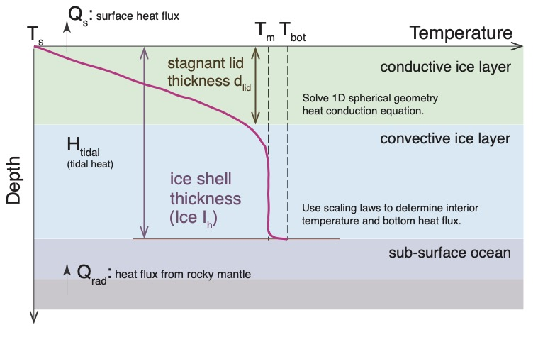
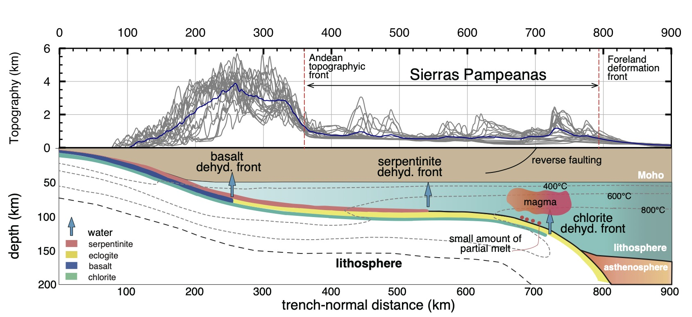
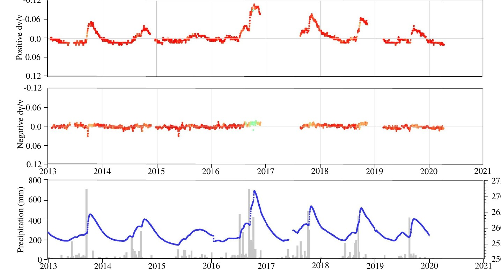



## Current research (Caltech)

### Is there a molten layer at the base of the Martian mantle?

*Planetary interiors · with Paul Asimow · 2026 to present*

- Combine thermodynamic modeling (HeFESTo) with seismic travel-time calculations in a Bayesian (MCMC) framework
- Infer the composition, temperature, and melt fraction of a basal mantle layer above the Martian core
- Test which InSight seismic observations can actually constrain this layer

### What controls the strength of subducting plates?

*Geodynamics · with Mike Gurnis · 2025 to present*

- Use adjoint-based Bayesian inversion of geodynamic models (Rhea)
- Infer subduction-zone rheology (viscosity, stress exponent, yield strength) from surface observations such as plate motions
- Quantify which parameters the data can and cannot resolve

## Previous research

### Tidal heating controls the thickness history of Europa's ice shell

*Planetary interiors · Research Assistant, Institute of Earth Sciences, Academia Sinica · with Frédéric Deschamps and Wen-Pin Hsieh*

Europa hides a deep ocean beneath a shell of ice, but how thick that shell is remains uncertain, with estimates ranging from a few kilometers to more than 50 km. We modeled how the ice shell evolves over time, testing the effects of ocean composition, ice viscosity, and tidal heating from Jupiter. We find that tidal heating and ice viscosity control the thickness, which is about 20 to 45 km, while ocean composition matters much less. Because Europa's orbit changes over time, the amount of tidal heating also changes, and this can make the ice shell thicken or thin by tens of kilometers. These results help reconcile ice thickness estimates from surface geology with those from thermal evolution models.

<figure>
  
  <figcaption>Schematic of the ice shell model: a conductive lid above a convecting ice layer, heated by tidal dissipation (after Hussmann, 2002).</figcaption>
</figure>

**More:**

- [Chen et al., 2026, JGR Planets](https://doi.org/10.1029/2024JE008928)
- [Code](https://github.com/chingchenn/Europa_ice_shell)

### Slab dehydration and mantle wedge weakening control flat slab subduction in Chile and Peru

*Geodynamics · MS research, National Taiwan University · with Eh Tan*

Flat slab subduction is usually explained by extra buoyancy from subducting ridges or oceanic plateaus. We take a different perspective: dehydration of the subducting slab releases water that, together with magmatism, weakens the mantle wedge and the plate boundary. In this study, we show that this weakening process strongly affects subduction dynamics, and that a lack of water can lead to flat slab formation. Applying our models to the Chilean and Peruvian subduction zones, we find that the predicted locations of magmatism and mountain building agree with observations.

<figure>
  
  <figcaption>Dehydration fronts, magmatism, and topography above the Pampean flat slab. Water released from the slab controls where the mantle wedge weakens and where magma forms.</figcaption>
</figure>

**More:**

- [Chen and Tan, 2025, preprint (mechanism)](https://doi.org/10.22541/essoar.173757637.73898113/v1)
- [Chen and Tan, 2025, preprint (Pampean flat slab)](https://doi.org/10.22541/essoar.173757632.22182677/v1)
- [MS thesis, National Taiwan University, 2022](http://tdr.lib.ntu.edu.tw/jspui/handle/123456789/83257)
- [Code](https://github.com/chingchenn/geoflac/tree/flat)

### Groundwater drives seasonal seismic velocity changes in the Longitudinal Valley, Taiwan

*Seismology · Undergraduate research, Institute of Earth Sciences, Academia Sinica*

Groundwater changes the properties of shallow rocks and sediments, which in turn changes how fast seismic waves travel through them. We used continuous ambient seismic noise, mostly generated by human activity, recorded by a local seismic array in Chihshang, eastern Taiwan, from 2013 to 2020. By cross-correlating the noise between station pairs, we tracked daily changes in seismic velocity. We find seasonal velocity drops of up to 12% that closely follow the rise of groundwater after each rainy season, with no time lag between the two. Because the signal appears only at frequencies above 3 Hz, the changes come from the top ~30 m, within the thick gravel layer of the Longitudinal Valley. These results show that ambient seismic noise can be used to monitor groundwater storage over time.

<figure>
  
  <figcaption>Seismic velocity change (top) compared with rainfall (gray bars) and groundwater level (blue), 2013 to 2020. Velocity drops each time the groundwater level rises after the rainy season.</figcaption>
</figure>

**More:**

- [Poster, Taiwan Geosciences Assembly 2020](https://ching602504.wordpress.com/wp-content/uploads/2024/11/tga_poster_v6.pdf)
